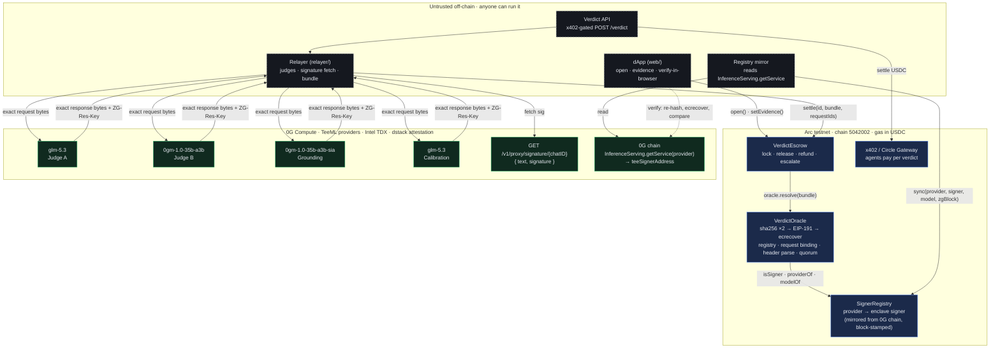

# ⚖️ Verdict

**The first escrow that only pays when an enclave signed the verdict.**

USDC escrow on Arc, resolved by LLM judges running inside Intel TDX on 0G Compute, verified on-chain with nothing but `sha256` and `ecrecover`.

[](#verified-so-far)
[](https://docs.0g.ai)
[](https://docs.arc.io)
[](https://developers.circle.com/agent-stack)
[](https://ethglobal.com/events/mumbai)

> No relayer to trust. No committee. No seven-day dispute window.

A `VerdictEscrow` moves USDC only when a bundle of model outputs recovers, on-chain, to enclave signing keys that 0G publishes in `InferenceServing`. Tamper one byte of the prompt or the reply and `ecrecover` returns a stranger. Replay a real verdict from another escrow and the hash binding rejects it.

## Why this exists

Every "AI oracle" today asks you to trust something squishy:

| Approach | What you actually trust | Latency |
|---|---|---|
| UMA / optimistic | that a disputer shows up and a token vote is honest | days |
| Chainlink Functions / CRE + LLM | that the DON relayed what some API said (no proof of which model ran, or where) | minutes |
| opML (ORA) | a fraud-proof game over deterministic compute; useless for sampling models | 7-day window |
| zkML | hours per 70B inference; no frontier model fits | hours |
| `verify_tee: true` on a router | that the router did the check honestly and returned a boolean | seconds |

Verdict trusts hardware attestation + one `ecrecover`. The model ran in a TDX enclave on 0G; the enclave key is on-chain; the contract checks the signature itself. ~40k gas per attestation on top of the SHA-256 precompile. Settlement is one transaction.

## System architecture



**Trust boundary in one sentence:** the top box holds the money, the bottom box holds the keys, and the middle box can be malicious without changing the outcome.

## One settlement, step by step

```mermaid
sequenceDiagram
    autonumber
    participant Payer
    participant Payee
    participant Escrow as VerdictEscrow (Arc)
    participant Relayer
    participant TEE as TeeML provider (0G, TDX)
    participant Oracle as VerdictOracle (Arc)

    Payer->>Escrow: open(payee, 50 USDC, deadline, rubric, policy)
    Note over Escrow: stores keccak(rubric)
    Payee->>Escrow: setEvidence(id, keccak(evidence))
    loop 4 attestations (judge A, judge B, grounding, calibration)
        Relayer->>TEE: POST /v1/proxy/chat/completions  (exact bytes REQ)
        Note over TEE: prompt names RUBRIC + EVID hashes<br/>reply starts with VERDICT:Y;CONF:0.93;RUBRIC:0x…;EVID:0x…;
        TEE-->>Relayer: exact bytes RESP + ZG-Res-Key
        Relayer->>TEE: GET /v1/proxy/signature/{chatID}
        TEE-->>Relayer: text = sha256(REQ):sha256(RESP), signature (EIP-191)
        Relayer->>Relayer: recompute hashes, verifyMessage vs 0G Service.teeSignerAddress
    end
    Relayer->>Escrow: settle(id, [REQ,RESP,sig,provider]×4, requestIds)
    Escrow->>Oracle: resolve(rubricHash, evidenceHash, policy, bundle)
    Note over Oracle: sha256(REQ) ":" sha256(RESP) → toEthSignedMessageHash → ecrecover<br/>signer ∈ SignerRegistry? REQ contains both hashes? RESP header hashes match?<br/>2 distinct models agree? grounded? conf ≥ 0.85?
    Oracle-->>Escrow: YES | NO | ESCALATE
    Escrow-->>Payee: 50 USDC (YES)  — or refund (NO) — or freeze for arbiter (ESCALATE)
```

## What the enclave actually signs

We read the 0G broker source instead of the docs. Good thing, too.

[`0g-serving-broker/api/inference/internal/ctrl/signing.go`](https://github.com/0gfoundation/0g-serving-broker), `signChatWithKey`:

```text
text      = hex(sha256(requestBody)) + ":" + hex(sha256(responseBody))   // lowercase, 129 chars
signature = personal_sign(text) by teeSignerAddress                      // EIP-191, v ∈ {27,28}
```

served at `GET {provider.url}/v1/proxy/signature/{chatID}?model=` as `{text, signature, signing_address}`; `chatID` is the `ZG-Res-Key` response header.

**Consequence:** to bind a signature to content on-chain you need the *exact* bytes that were hashed. You only hold those when you call the provider directly (`{url}/v1/proxy/chat/completions`, wallet-signed billing headers from `@0gfoundation/0g-compute-ts-sdk`). Through the router the request is rewritten; in `private` mode the gateway seals it. So Verdict runs **Direct mode**: the model still executes inside the enclave (that is what TeeML means), transit is TLS, and the relayer keeps every byte.

## The verdict header

The judge prompt forces the reply to begin with a fixed-width header. The contract finds it inside the response JSON (`"content":"VERDICT:…`) and parses by byte offset. No JSON parser on-chain.

```text
VERDICT:Y;CONF:0.93;RUBRIC:0x<64 hex>;EVID:0x<64 hex>;<rationale ≤ 900 chars>
^0      ^8 ^10   ^15  ^20     ^27      ^93  ^99        ^165
```

`VerdictOracle.verifyOne` does, in order:

1. `signedText = hex(sha256(req)) ":" hex(sha256(resp))` → `toEthSignedMessageHash` → `recover`
2. signer is active in `SignerRegistry` and mapped to the provider the bundle claims
3. the request bytes contain both escrow hashes (the prompt the enclave saw named *this* escrow)
4. the response header's `RUBRIC` / `EVID` equal the escrow's stored hashes

A tampered byte in either body dies at step 1. A genuine signature from a different escrow dies at 3 or 4.

`resolve` applies the per-escrow policy — judges distinct models, `minAgree`, `minConfBps` from the calibration attestation, `requireGrounded` from the grounding attestation — and returns `YES`, `NO` or `ESCALATE`. Escalation freezes the escrow for the named arbiter, or refunds the payer after the deadline. The policy defaults (unanimity + confidence floor) are the regime where multi-LLM ensembles hit ~98% on prediction-market resolution; 2–1 splits are a coin flip, so we never auto-settle them.

## The pipeline

Two modes, same contracts, chosen by `.env`:

| Mode | 0G chain | Judges | Cost | Status |
|---|---|---|---|---|
| **Two-model** (`JUDGES=2`) | mainnet `16661` | 2 distinct model families must agree | ~4.5 0G deposit, < 1 0G spent | designed for this; needs mainnet 0G |
| **Single-judge** (`JUDGES=1`) | Galileo testnet `16602` | 1 judge + grounding + calibration | free (faucet 0G) | **current `.env`** |

### Two-model (mainnet)

| Role | Model (0G id) | Provider | Enclave signer | Why |
|---|---|---|---|---|
| Judge A | `glm-5.3` | `0xD179…E503` | `0x0766…9179` | 1M-context reasoner, TeeML |
| Judge B | `0gm-1.0-35b-a3b` | `0xf4FB…B250` | `0xDdaE…0Bfb` | different model family, TeeML |
| Grounding | `0gm-1.0-35b-a3b-sia` | `0x15aD…Eabe` | `0xbDb8…8CE7` | reward-guided "honesty" variant; flags claims the evidence doesn't support |
| Calibration | `glm-5.3` | `0xD179…E503` | `0x0766…9179` | sees both verdicts; emits a calibrated probability |

All records read live from 0G mainnet `InferenceServing` [`0x47340d900bdFec2BD393c626E12ea0656F938d84`](https://chainscan.0g.ai/address/0x47340d900bdFec2BD393c626E12ea0656F938d84): `verifiability: TeeML`, `teeSignerAcknowledged: true`, `TargetSeparated: false`, image `ghcr.io/0gfoundation/0g-serving-broker`, verifier `dstack`. Judges never see each other's output (independent verdicts beat deliberation); only grounding and calibration see the rationales. `temperature: 0` everywhere.

### Single-judge (Galileo testnet)

On Nov 7, 2026 we listed every service on both Galileo `InferenceServing` contracts (`0xa79F…F91E`, `0x41bD…85c5`) and probed each signature endpoint. Exactly one acknowledged TeeML chat provider answered:

| Role | Model | Provider | Enclave signer |
|---|---|---|---|
| Judge, Grounding, Calibration | `qwen/qwen3.8-omni-flash` | `0xd6269e257761705B9e442E59794703762DFcC940` | `0x6e1467340F9df9A314C4534461e0754FA38b872f` |

The testnet `glm-5.3` provider's dstack gateway returns 502; the others are unacknowledged or their hosts no longer resolve. The contract needed no change: `Policy{judges:1, minAgree:1}` was always valid, and the distinct-model rule applies only to judges.

**What this mode claims, honestly.** This provider is `ProviderType: centralized` (`aliyun`, `TargetSeparated: true`): the 0G broker runs in Intel TDX and signs `sha256(req):sha256(resp)` with its enclave key, but the model itself runs on Alibaba Cloud. So the on-chain claim narrows from *"this model ran in this enclave"* to *"an attested 0G enclave forwarded exactly this prompt to Qwen and got back exactly this reply"*: provenance, like zkTLS, rather than confidential execution. And with one judge, a single model family decides; grounding and the confidence floor still gate release. Switching back is `.env` only: `JUDGES=2`, mainnet RPC/contract, two model ids.

## Verified so far

- **`forge test` → 20/20.** Single-judge release on YES and escalate when ungrounded · release on YES · refund on NO · escalate on disagreement / low confidence / ungrounded · arbiter path · tampered response · tampered request · replay from another escrow · header for the wrong escrow · missing header · unregistered signer · revoked signer · provider mismatch · same model twice · refund after deadline · signed-text format equals the broker's.
- **Galileo testnet.** `providers.ts` resolves `qwen/qwen3.8-omni-flash` from `InferenceServing.getAllServices`; its signature endpoint answers `404 chat_id_not_found`. Its enclave signer is mirrored into `SignerRegistry` ([`0xc4f404da…`](https://explorer.testnet.arc.io/tx/0xc4f404da0f4e9055ede7f78738cac1cb58b0cd4570046f108a6f4223de430575), 0G testnet block 64228313).
- **Live 0G reads.** `bun run src/providers.ts <model>` hits the real `InferenceServing` and each provider's signature endpoint (answers `404 chat_id_not_found` for an unknown id, as it should).
- **Arc testnet.** chain `5042002`, ERC-20 USDC `0x3600…` = 6 decimals (native gas USDC = 18).
- **Relayer** typechecks, Direct mode, byte-exact verification before any gas is spent.

## Run it for real

```bash
# 0. clone + deps
git clone https://github.com/Atharv181/verdict && cd verdict
(cd relayer && bun install)                # contracts/lib is vendored; nothing to install there
cp .env.example .env

# 1. 0G wallet → .env ZG_PRIVATE_KEY
#    testnet (default .env.example): ~3.5 0G from the 0G faucet (3 ledger min + ZG_SUB_FUND=0.5)
#    mainnet: ~4.5 0G (3 ledger + 0.5 × 3 providers); the ledger deposit can be withdrawn afterwards
(cd relayer && bun run src/fund.ts)        # ledger + sub-accounts; skips sub-accounts already funded

# 2. Arc: fund ARC_ADDRESS and PAYEE_ADDRESS from https://faucet.circle.com (Arc Testnet)

# 3. everything
./scripts/run-e2e.sh                       # deploy → spike → mirror signers → pass / fail / injected

# 4. verify any settlement from public data only
(cd relayer && bun run src/verify.ts 0x<settle tx>)
```

Open `web/index.html` (or the GitHub Pages deployment) to open escrows, commit evidence, and run the same verification in your browser — it decodes the settle calldata, re-hashes the bytes, recovers the signers and reads 0G chain itself.

Piecewise: `scripts/deploy.sh` · `bun run src/spike.ts [model]` · `bun run src/registry-mirror.ts` · `bun run src/e2e.ts pass|fail|injected` · `bun run src/api.ts` (x402).

## Repository

```text
contracts/   Foundry (via-IR). SignerRegistry · VerdictOracle · VerdictEscrow · 20 tests · Deploy script
relayer/     Bun + viem + 0G SDK. Direct-mode client, judges, signature fetch, registry mirror,
             e2e on Arc, independent verifier, x402 API (Circle facilitator), funding helper
web/         Zero-build dApp: wallet, open, evidence, state, in-browser verification
scripts/     deploy.sh · run-e2e.sh
FEEDBACK.md  what we'd fix in 0G's and Arc's docs after building this
```

## Threat model, honestly

| Attack | Stopped by |
|---|---|
| forge or edit a verdict | `ecrecover` — no enclave key, no signature |
| replay a real verdict from another escrow | hashes in the request and the signed header must equal storage |
| prompt-injected evidence | evidence is fenced as untrusted; grounding flags unsupported claims; two model families must agree (single-judge mode: one family, plus grounding and the confidence floor); disagreement → `ESCALATE` (demoed in the `injected` case) |
| reroll until a borderline case flips | `temperature: 0`, unanimity + confidence floor, every attempt leaves a request id |
| compromised relayer / router | neither holds enclave keys; worst case is liveness |
| compromised `SignerRegistry` owner (hackathon) | the one trusted step; every `Synced` event carries the 0G block read; roadmap = 0G state proof on Arc |
| TDX break / malicious operator | out of scope; same assumption as every TEE system |

**Claimed:** this model, in this enclave, received exactly this prompt and produced exactly this reply. (Single-judge testnet mode: this enclave relayed exactly this prompt and reply to and from a centralized model; see above.)
**Not claimed:** that the evidence is real, or that the model is right.

## Tracks

- **0G — Build with 0G Private Computer.** Inference is the product; request ids are in every `Settled` event; remove 0G and there is nothing to verify.
- **Arc — Best Smart Contracts with Advanced Stablecoin Logic.** Conditional USDC escrow with on-chain dispute and automatic release; `VerdictOracle` is reusable by any Arc contract.

## Deployed addresses

Arc testnet (chain `5042002`), deployed by `scripts/deploy.sh`, also in [`web/addresses.json`](web/addresses.json):

| Contract | Address | Deploy tx |
|---|---|---|
| SignerRegistry | [`0x0148950580C3F20855b49f199CF254D602E489A6`](https://explorer.testnet.arc.io/address/0x0148950580C3F20855b49f199CF254D602E489A6) | [`0x36e31a75…`](https://explorer.testnet.arc.io/tx/0x36e31a756c533148f90f94a9960fbac51bd56e819bcf7a91600b86d775ad9d8f) |
| VerdictOracle | [`0xdff4D8727642CbED13dC1Df29A1EfE70a59C4cbE`](https://explorer.testnet.arc.io/address/0xdff4D8727642CbED13dC1Df29A1EfE70a59C4cbE) | [`0xed154067…`](https://explorer.testnet.arc.io/tx/0xed154067c84b7a4c384d94ac9d5e74ba44b24ddb78b1350414cdeaf894c1aadd) |
| VerdictEscrow | [`0x49bdAB3BAdDdCed369347b89325b7Af058440359`](https://explorer.testnet.arc.io/address/0x49bdAB3BAdDdCed369347b89325b7Af058440359) | [`0xc6634150…`](https://explorer.testnet.arc.io/tx/0xc663415031a020e51e67664d031795383330fb7521e3b184e16e63126e74cc07) |

Enclave signers mirrored into `SignerRegistry` by `bun run src/registry-mirror.ts`, each read from 0G mainnet `InferenceServing` at the block shown:

| Model (`Service.model`) | Provider | Enclave signer | 0G block | Sync tx |
|---|---|---|---|---|
| `glm-5.3` | `0xD179F4526064846dE9a9E9D93683AF75CB72E503` | `0x0766BC72beB6dAe764eE51C781c0A68117E69179` | 49488212 | [`0x0b7c397b…`](https://explorer.testnet.arc.io/tx/0x0b7c397ba35ea41ff3ccbdf0689a63df8b39981e75f96c955c3383560fcf1131) |
| `0GM-1.0-35B-A3B` | `0xf4FB8d2bD856e672b5f9848b0eD235A20079B250` | `0xDdaEaac4d8525d72DfD20cc6dE0f28eb3d320Bfb` | 49488219 | [`0x29f75924…`](https://explorer.testnet.arc.io/tx/0x29f759243e08ad4d1b797eb619be91e57a739020a690ae874561f8400c2fb028) |
| `0GM-1.0-35B-A3B-SIA` | `0x15aDd680050Ecd0B25eb7d480e7BB1f48594Eabe` | `0xbDb8daCECec80319128C1E52A15053f04C6F8CE7` | 49488219 | [`0x8332fe3d…`](https://explorer.testnet.arc.io/tx/0x8332fe3d4ce10f06ce6899c9d1f204903285bc891d874c9d7d7cf7ee73d10e69) |

Galileo testnet signer (single-judge mode), read from `InferenceServing` `0xa79F4c8311FF93C06b8CfB403690cc987c93F91E`:

| Model (`Service.model`) | Provider | Enclave signer | 0G block | Sync tx |
|---|---|---|---|---|
| `qwen/qwen3.8-omni-flash` | `0xd6269e257761705B9e442E59794703762DFcC940` | `0x6e1467340F9df9A314C4534461e0754FA38b872f` | 64228313 | [`0xc4f404da…`](https://explorer.testnet.arc.io/tx/0xc4f404da0f4e9055ede7f78738cac1cb58b0cd4570046f108a6f4223de430575) |

---

Built at ETHGlobal Mumbai, Nov 2026. *Models judge; enclaves sign; contracts check. Nobody is trusted.*
